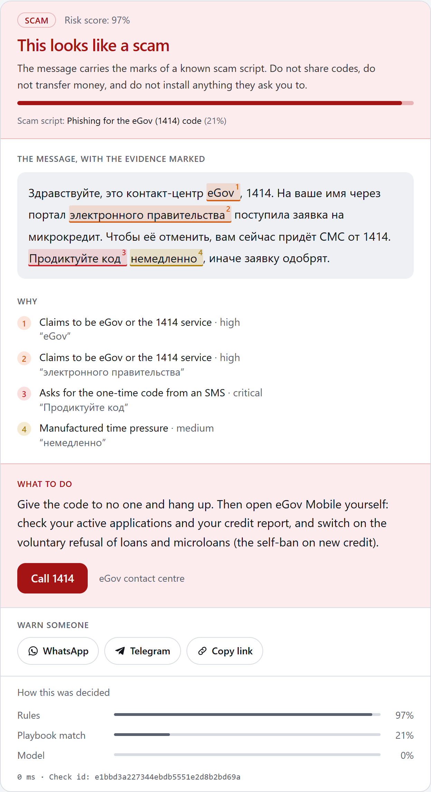
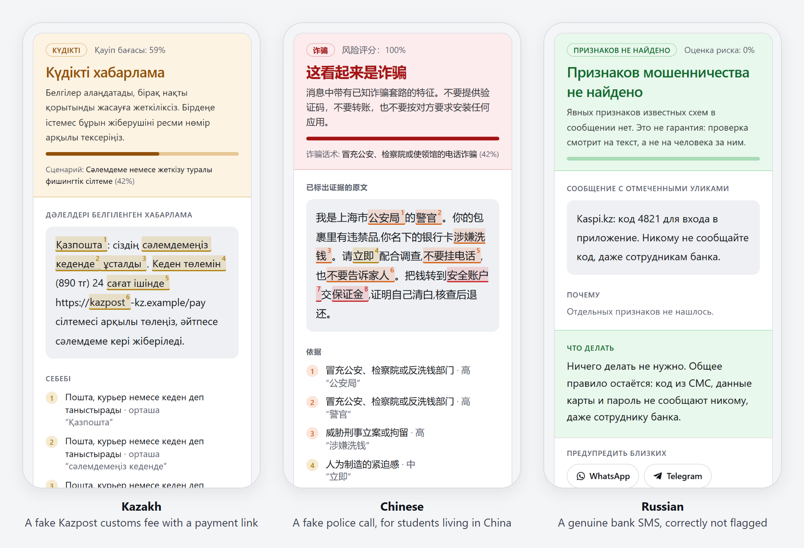
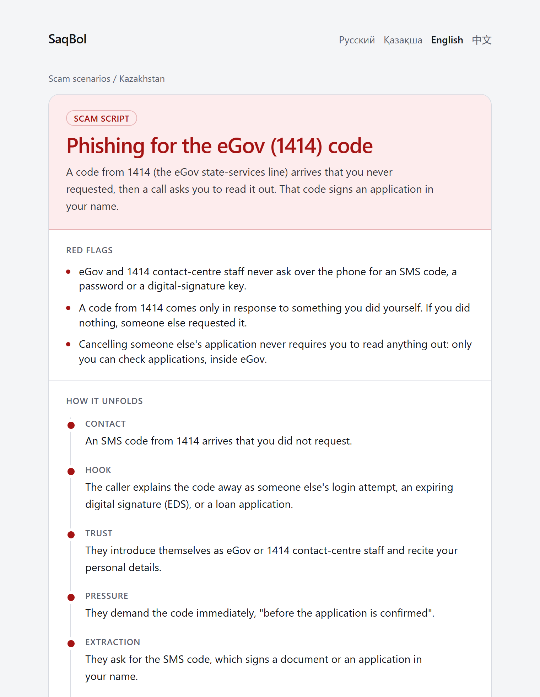

# SaqBol — Сақ бол

[](https://github.com/InfectedDuck/Scam-Detector/actions/workflows/ci.yml)


[](LICENSE)

**Explainable scam checking for Kazakhstan, in Kazakh, Russian, English and Chinese.** Paste a suspicious message and SaqBol tells you which known scam script it follows, marks the exact words that gave it away, and says what to do and who to call.

*Сақ бол* is Kazakh for "be careful".

> [!IMPORTANT]
> **Work in progress, not available to the public yet.** The engine, the web app, the API and the Telegram bot run end to end on a local machine. Nothing is deployed, the dataset has not been released, and no model has been evaluated. The [status table](#project-status) lists what works and what does not.

<p align="center">
  
</p>
<p align="center"><sub>Real output from the rules engine for a fake eGov message, with no language model involved. Each highlight is a character span matched by a specific rule.</sub></p>

## Project status

As of October 2026.

| Part | State |
|---|---|
| Rules engine: 50 indicators in 10 families, 13 scam scripts | Working and tested; runs offline |
| Web app in four languages | Working locally; not deployed |
| HTTP API | Working locally; not deployed |
| Telegram bot | Working locally with a bot token; not launched |
| Language-model layer (hybrid mode) | Built and unit-tested; not yet checked against live providers |
| Screenshot reading | Built; needs a vision-model key; not yet checked against a live provider |
| KazScam dataset | 126 rows collected from official warnings and news, 76 usable after filtering; annotation tool ready, independent double annotation not done; not released |
| Evaluation and leaderboard | Harness built and run in CI on test fixtures; no real results yet |
| Refusal probe (do models decline to analyse scam text?) | Harness built; not run yet |
| Public launch | Not started |

Until the leaderboard has numbers in it, nothing here is a claim about how accurate SaqBol is.

## Four languages, three kinds of answer

<p align="center">
  
</p>

The answer is one of four levels: scam, suspicious, unsure, or likely safe. The right-hand example is a genuine Kaspi login SMS. It contains the word "код" (code) and still comes back clean. Genuine bank, delivery and government messages like this one are a fixed part of the test suite, because a checker that flags every bank SMS stops being believed.

## Why

Most scam messages people in Kazakhstan receive are in Russian, Kazakh, or a mix of the two. Consumer anti-scam tools are mostly built for English or Chinese. I could not find an open, labelled dataset of this kind of text, so there is also no way to measure how well a language model handles it.

SaqBol is meant to be two things: a free tool that answers "is this a scam?" in the user's own language, and an open dataset and benchmark that show how well current models do on this text.

It also covers three scams aimed at foreign students in China, because that is where I live and study.

## How it works

A hybrid pipeline. A deterministic indicator engine runs first, with no network and no model. Retrieved scam playbooks then ground a language model that classifies into a closed set. The two are fused, and the system answers `unsure` when they disagree.

```
normalize → perceive → extract entities → [indicators ‖ retrieve playbooks] → judge → fuse → render
```

| Stage | What it does | Where |
|---|---|---|
| Normalize | NFKC, zero-width and bidi stripping, script-mix detection, language ID | `core/normalize.py` |
| Perceive | Screenshot to transcript with speaker turns through a vision model; bytes discarded | `core/perceive.py` |
| Extract | URLs, phones, cards (masked on sight), IIN, amounts, crypto, remote-access apps | `core/extract.py` |
| Indicators | 50 rules in ten families, Russian and Kazakh patterns, severity-weighted | `core/indicators/` |
| Retrieve | Lexical retrieval over 13 playbooks; dense retrieval is an ablation | `core/retrieval.py` |
| Judge | Structured output, confined to retrieved candidates, quotes verified against the text | `core/graph.py` |
| Fuse | Weighted risk, disagreement and self-consistency overrides, four bands | `core/fuse.py` |
| Render | Localized card from `i18n/{ru,kk,en,zh}.yaml`; identical key sets enforced by a test | `core/render.py` |

Two rules hold throughout. Every highlighted phrase is a verified character span in the message, including the ones the model quotes. And the advice and phone numbers come from a reviewed playbook file, never from the model.

The rules-only baseline will be its own row on the leaderboard, so the model's contribution gets measured rather than assumed. Full design in [docs/01_ARCHITECTURE.md](docs/01_ARCHITECTURE.md), and the reasoning behind each choice, including what went wrong, in [docs/DESIGN_DECISIONS.md](docs/DESIGN_DECISIONS.md).

## Scam scripts covered

| Kazakhstan | China (for foreign students) |
|---|---|
| Call from the "bank security service" | Fake police, prosecutor or embassy call |
| Phishing for the eGov (1414) code | Task-commission work and fake part-time jobs |
| Remote access to your phone and a loan in your name | Private currency exchange over a messenger |
| Installing an APK file sent in chat | |
| Phishing link about a parcel or delivery | |
| Fake shop asking for prepayment | |
| "Safe deal" link on OLX or Instagram | |
| Money request from a friend's hijacked account | |
| Investment platform advertised with a deepfake | |
| Renting out your card or account (money mule) | |

Each script is a YAML file in [`src/saqbol/playbooks/data/`](src/saqbol/playbooks/data/) with red flags, the stages the scam goes through, localized advice, hotlines and the public sources it was written from. The web app turns them into a readable library:

<details>
<summary>Screenshot: one page of the scam-script library</summary>
<br>

</details>

## Surfaces

| Surface | Entry point | Notes |
|---|---|---|
| Telegram bot | `python -m saqbol.bot.main` | Consent on `/start`, text, forwards, screenshots, feedback buttons, dataset opt-in |
| HTTP API | `uvicorn saqbol.api.main:app` | `POST /api/v1/analyze`, feedback, public stats, playbook library, `/healthz` |
| Web app | `cd web && npm run dev` | Analyze page with inline highlighting, share pages with Open Graph images, public stats, a playbook library in four languages |

All three run with nothing configured: no database means an in-memory store, no provider key means the rules-only pipeline, no vision key means screenshots are declined rather than faked.

The bot builds its reply from the same playbooks and translations as the web app. Condensed to plain text, its rules-only answer to a fake bank call looks like this:

```
> Здравствуйте, служба безопасности Kaspi. На ваше имя оформляют кредит.
> Продиктуйте код из СМС и переведите деньги на безопасный счёт.

  SCAM · risk 1.00 · kz.bank_security_call · Звонок «службы безопасности банка»
  Evidence:  служба безопасности · Продиктуйте код · код из СМС · безопасный счёт
  Do now:    Положите трубку. Перезвоните в банк сами — по номеру на обороте
             карты или через приложение, а не по тому номеру, который вам назвали.
  Call:      9999 (Kaspi) · 7111 (Halyk) · 505 (BCC) · 1414 (eGov) · 102 (police)
```

## Run it

One command, four containers, no internet needed after the images are built:

```bash
cp .env.example .env          # fill in what you have; blanks are fine
docker compose up --build
# web  → http://127.0.0.1:3000
# api  → http://127.0.0.1:8000/docs
```

For development without Docker:

```bash
python -m venv .venv
.venv/Scripts/activate                      # Windows; source .venv/bin/activate elsewhere
pip install -e ".[api,bot,eval,dev]"
pytest                                      # no network, no keys
ruff check src tests

uvicorn saqbol.api.main:app --reload        # API on :8000, rules-only until a key is set
cd web && npm install && npm run dev        # web on :3000, mock verdicts until SAQBOL_API_BASE is set
```

Set `DEEPSEEK_API_KEY` or `DASHSCOPE_API_KEY` in `.env` to switch the pipeline from rules-only to hybrid. Set `DASHSCOPE_API_KEY` to enable screenshots. Model responses are recorded as they are made, and `SAQBOL_LLM_OFFLINE=1` replays them and refuses to make new calls, so a rerun costs nothing.

## Testing

- 1,370+ Python tests. All of them run with no network and no API keys.
- Golden cases for each of the 13 scam scripts in Russian, Kazakh and mixed Russian-Kazakh text, plus Chinese for the China scripts; 25 genuine messages that must not be flagged; and a set of prompt-injection attempts.
- CI on every push: lint, format check, tests with coverage, and an offline evaluation run from config to leaderboard. For the web app: typecheck, component tests, a production build, and a smoke test of every sample page in all four languages.

## Evaluation

```bash
python -m saqbol.eval run --config eval/configs/v0.1.yaml
python -m saqbol.eval leaderboard --results eval/runs/<id>/results.json --out leaderboard.md
```

The matrix is systems × models × splits × languages × ablations. Every number will carry a stratified bootstrap confidence interval with 10,000 resamples, and the leaderboard generator refuses to print "beats" where intervals overlap.

| System | Models | Splits | Ablations |
|---|---|---|---|
| `rules_only`, `llm_zeroshot`, `hybrid` | DeepSeek V4.1 Flash, Qwen3, GPT-4o-mini, Llama-3.3-70B | `test_press`, `test_donated` | `translated`, `cue_masked`, `no_playbook_context` |

**Leaderboard: not yet run.** It needs an annotated, held-out test set and provider keys. The table will be generated into this section, never hand-edited. Protocol in [docs/05_EVAL_PROTOCOL.md](docs/05_EVAL_PROTOCOL.md).

## KazScam dataset

The plan: messages from official warnings and the press, each with a source URL and access date, PII scrubbed with typed placeholders, double-annotated against a written guideline with per-class Cohen's kappa reported, and split so that no near-duplicate crosses a split boundary. Genuine messages that look like scams are a required part of the test set.

Where it is now: 126 rows collected (92 from news, 34 from official warnings), 76 of them usable after removing fragments. The provisional splits were all looked at while writing the rules, so they count as development data, and a fresh held-out set still has to be collected ([why](docs/DESIGN_DECISIONS.md#a-contamination-note-for-the-rules-only-row)). [Datasheet draft](data/DATASHEET.md). Guideline: [docs/07_ANNOTATION_GUIDELINE.md](docs/07_ANNOTATION_GUIDELINE.md). Sources and redistribution basis: [docs/09_SOURCES.md](docs/09_SOURCES.md).

## Privacy

The tool never asks for a code, a card number, or a phone number. Screenshots are turned into text in memory and the bytes are dropped; a test asserts they reach neither a table nor a log line. Identifiers are HMAC-hashed before they reach the database. Stored text expires after 30 days. Nothing enters the dataset without an explicit per-submission opt-in, and even then it lands in a review queue. Full policy in [PRIVACY.md](PRIVACY.md).

## Limitations

- Text and screenshots only. No voice notes, no APK analysis, no fine-tuned model in v1.
- The Kazakh rule set was written by one person and is marked for native-speaker review in the lexicon file. Until that review, the Kazakh numbers measure the author as much as the language.
- The hybrid pipeline depends on a model provider that is reachable from both Kazakhstan and mainland China. Rules-only is the fallback and is honest about being weaker.
- Stage detection uses only the messages in one conversation window. It says nothing about a scam that spans days.
- No leaderboard number exists yet. Any claim about model quality before it is published is a plan, not a result.

## What comes next

1. Check the model and vision layers against live providers.
2. Recruit annotators, run the annotation pilot, and measure agreement.
3. Collect a fresh held-out test set, freeze it, and run the leaderboard.
4. A small public pilot of the web app and the bot.
5. Release KazScam v0.1 on Hugging Face with its datasheet.

## Documentation

| Document | Contents |
|---|---|
| [docs/01_ARCHITECTURE.md](docs/01_ARCHITECTURE.md) | Pipeline, stack, deployment |
| [docs/02_DATA_CONTRACTS.md](docs/02_DATA_CONTRACTS.md) | Every schema |
| [docs/03_INDICATORS.md](docs/03_INDICATORS.md) | The deterministic detection rules |
| [docs/04_PLAYBOOKS.md](docs/04_PLAYBOOKS.md) | The thirteen scam scripts |
| [docs/05_EVAL_PROTOCOL.md](docs/05_EVAL_PROTOCOL.md) | Dataset, annotation, metrics |
| [docs/07_ANNOTATION_GUIDELINE.md](docs/07_ANNOTATION_GUIDELINE.md) | How a message gets its label |
| [docs/08_REFUSAL_PROBE.md](docs/08_REFUSAL_PROBE.md) | Whether providers decline to analyse scam text, by language |
| [docs/09_SOURCES.md](docs/09_SOURCES.md) | Where the corpus comes from and on what basis it can be redistributed |
| [docs/DESIGN_DECISIONS.md](docs/DESIGN_DECISIONS.md) | Why each choice was made, and what went wrong |
| [data/DATASHEET.md](data/DATASHEET.md) | Datasheet draft for KazScam v0.1 |
| [docs/10_REMAINING_ROADMAP.md](docs/10_REMAINING_ROADMAP.md) | Remaining work, dependencies and release gates |
| [docs/PARALLEL_LANES.md](docs/PARALLEL_LANES.md), [docs/11_CODEX_MINI_PLANS.md](docs/11_CODEX_MINI_PLANS.md) | How the implementation work was split into tasks for AI coding assistants |

## Contributing

Native Kazakh and Russian speakers are the contributors this project needs most, and no programming is required: see [CONTRIBUTING.md](CONTRIBUTING.md). Security reports: [SECURITY.md](SECURITY.md).

## Licence

MIT for the code. The dataset will carry its own licence and datasheet, released separately.

Built by Toktar Kametay. AI coding assistants were used during implementation; the design, data and evaluation decisions are mine.
